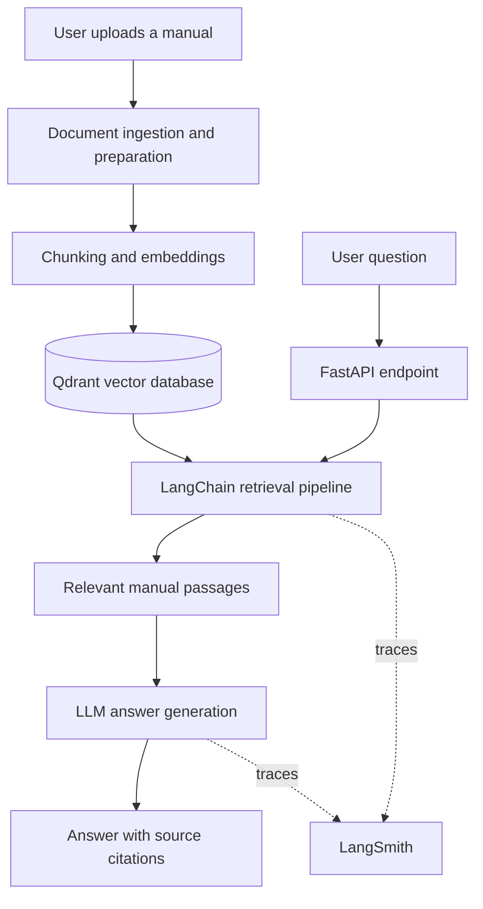

# DocLens — RAG Manual Troubleshooter

DocLens is a Retrieval-Augmented Generation (RAG) troubleshooting assistant that answers questions using uploaded manuals. It uses **LangChain** to orchestrate retrieval and generation, **Qdrant** for semantic search, and **LangSmith** to trace LLM calls and retrieval steps. Answers are designed to include source citations so users can verify the information against the original manual.

> **Project note:** This README is based on the current project description. The exact API routes, document formats, embedding model, LLM provider, chunking strategy, and repository module names were not included in the project material, so they are intentionally not invented below. Replace the marked integration points with the names and configuration used in your codebase.

---

## Table of Contents

- [What DocLens Does](#what-doclens-does)
- [Technology Stack](#technology-stack)
- [RAG Architecture](#rag-architecture)
- [Evaluation Strategy](#evaluation-strategy)
- [Evaluation Metrics](#evaluation-metrics)
- [Evaluation Dataset](#evaluation-dataset)
- [Integrating the Evaluation Runner](#integrating-the-evaluation-runner)
- [Setup](#setup)
- [Running Evaluations](#running-evaluations)
- [LangSmith Tracing and Experiments](#langsmith-tracing-and-experiments)
- [CI Regression Checks](#ci-regression-checks)
- [Recommended Evaluation Gates](#recommended-evaluation-gates)
- [Known Limitations and Next Steps](#known-limitations-and-next-steps)
- [References](#references)

## What DocLens Does

- Accepts questions about uploaded technical or product manuals.
- Uses semantic retrieval to find relevant manual passages in Qdrant.
- Uses a LangChain RAG pipeline to generate an answer from the retrieved context.
- Returns citation-backed answers so users can inspect the supporting source.
- Uses LangSmith tracing to inspect LLM calls and retrieval steps while debugging answer quality.

## Technology Stack

| Layer | Technology | Responsibility |
|---|---|---|
| API / backend | Python, FastAPI | Application and API layer |
| RAG orchestration | LangChain | Retrieval and answer-generation workflow |
| Vector database | Qdrant | Semantic search over manual content |
| Observability | LangSmith | Tracing, debugging, and experiment inspection |
| Evaluation | DeepEval | RAG retrieval and generation quality metrics |
| Automated tests | pytest | Deterministic tests and regression checks |

## RAG Architecture

The following is the logical RAG flow. It is not a claim about the exact internal module names or implementation details.



A useful RAG evaluation must inspect both sides of the pipeline:

1. **Retrieval:** Did DocLens retrieve the right manual passages, and rank them well?
2. **Generation:** Did the model produce a useful answer that is supported by those passages?

Evaluating only the final answer makes it difficult to identify whether a failure came from retrieval, generation, or citation handling.

## Evaluation Strategy

DocLens uses a layered evaluation approach. **DeepEval is the primary RAG evaluation framework**, pytest handles deterministic application checks, and LangSmith stores traces and supports experiment comparison. Ragas is not required as a second evaluation framework for the initial implementation because its core RAG metrics overlap with the selected DeepEval metrics.

| Evaluation layer | What it checks | How it is checked |
|---|---|---|
| Retrieval quality | Relevance, completeness, and ranking of retrieved passages | DeepEval metrics + labelled examples |
| Answer quality | Relevance and correctness of the generated answer | DeepEval metrics + reference answers |
| Grounding | Whether claims are supported by retrieved manual content | Faithfulness evaluation |
| Citation integrity | Whether citations point to passages actually retrieved by the system | Deterministic pytest checks |
| Abstention | Whether DocLens avoids inventing an answer when the manual lacks the information | Dedicated unanswerable test cases + human review |
| Reliability | Whether changes introduce regressions | pytest + repeatable evaluation dataset |
| Observability | Which retrieval and generation steps caused a failure | LangSmith traces and experiment comparisons |
| Performance | Request latency and, where available, token / model cost | Application instrumentation and recorded run metadata |

### 1. Retrieval evaluation

- **Contextual Precision:** checks whether relevant passages are ranked ahead of irrelevant passages.
- **Contextual Recall:** checks whether the retrieved passages contain the information needed to answer the question.
- **Contextual Relevancy:** checks whether the retrieved context is relevant to the question rather than filled with unnecessary material.

Use reference answers and, ideally, labelled relevant chunk IDs for the strongest retrieval evaluation. A reference answer can help estimate recall, but manually labelled relevant passages provide a more direct retrieval ground truth.

### 2. Answer-generation evaluation

- **Faithfulness:** checks whether the generated answer is supported by the retrieved context.
- **Answer Relevancy:** checks whether the response actually addresses the user's question.
- **Answer Correctness:** compares the response with a human-written reference answer. Use a rubric-based judge or human review; do not treat an LLM judge score as unquestionable ground truth.

### 3. Citation evaluation

Citation checks should be both deterministic and evidence-based:

- Every citation identifier must exist in the retrieved-context set for that request.
- Every citation must resolve to a real source location in the manual, such as a page, section, or chunk identifier, depending on the citation format DocLens implements.
- A citation being present is not enough: the cited passage must actually support the claim beside it. Assess this with human-reviewed examples and/or a carefully defined judge rubric.

The first two checks can be automated without an LLM. The third needs semantic evaluation or human review.

### 4. Abstention and edge-case evaluation

Add test examples for:

- A question whose answer is explicitly present in the manual.
- A question that combines information from multiple manual sections.
- A question whose answer is not present in the uploaded manual.
- Ambiguous wording or missing model / product details.
- A question that attempts to make the assistant ignore the manual and invent a procedure.
- Conflicting or outdated statements across manual sections, where applicable.

For unanswerable questions, the expected behavior should be a clear statement that the available manual does not provide enough information—not a plausible-sounding guess.

## Evaluation Metrics

The initial DeepEval suite should use the five core RAG metrics below:

| Metric | Evaluates | Main failure it helps identify |
|---|---|---|
| `ContextualPrecisionMetric` | Retriever ranking | Relevant passages are present but buried under irrelevant results |
| `ContextualRecallMetric` | Retriever coverage | Important information was not retrieved |
| `ContextualRelevancyMetric` | Retrieved-context relevance | Too much unrelated context reaches the generator |
| `FaithfulnessMetric` | Grounding of the answer | The answer adds claims unsupported by the retrieved passages |
| `AnswerRelevancyMetric` | Answer usefulness | The answer does not directly address the question |

For labelled examples, include an `expected_output` so the retrieval precision/recall metrics can use the reference. Faithfulness, answer relevancy, and contextual relevancy can also be run on examples without a reference answer, provided the required runtime fields are captured.

## Evaluation Dataset

Create a small, manually verified **golden dataset** before trying to optimize scores. Start with 30–50 representative questions from the manuals you actually support, then expand it as real failure cases are discovered. Do not create reference answers by copying the model's own output without review.

Suggested file: `evals/goldens.jsonl`.

Each line should be one JSON object:

```json
{
  "id": "manual-question-001",
  "input": "A question grounded in one of the supported manuals",
  "expected_output": "A human-verified answer based on that manual",
  "relevant_chunk_ids": ["chunk-id-from-your-index"],
  "answerable": true,
  "expected_citation_ids": ["chunk-id-from-your-index"],
  "tags": ["retrieval", "single-section"]
}
```

Field guidance:

| Field | Required | Purpose |
|---|---|---|
| `id` | Yes | Stable identifier for regression tracking |
| `input` | Yes | User question |
| `expected_output` | For reference-based evaluation | Human-verified target answer |
| `relevant_chunk_ids` | Strongly recommended | Ground truth for retrieval coverage and ranking |
| `answerable` | Yes | Expected answerability from the available manual |
| `expected_citation_ids` | Recommended | Expected source locations for citation checks |
| `tags` | Optional | Categorize cases by failure mode or question type |

Maintain examples across different manuals, sections, question difficulty levels, and answerability. Keep a separate holdout set for final comparisons so that prompt tuning does not overfit the evaluation questions.

## Integrating the Evaluation Runner

The evaluation runner needs a small adapter around the existing DocLens RAG function or API. The adapter should return a stable structure regardless of the internal LangChain implementation:

```python
{
    "answer": "Generated answer text",
    "retrieved_contexts": [
        {"id": "chunk-123", "text": "Retrieved manual passage"}
    ],
    "citations": [
        {"chunk_id": "chunk-123", "source": "manual.pdf", "page": 12}
    ],
    "latency_ms": 420,
    "input_tokens": 100,
    "output_tokens": 180
}
```

This is the **evaluation adapter contract**, not a statement that DocLens currently returns these exact keys. Map the existing response and retriever objects to this structure in `evals/adapter.py`.

### Example DeepEval runner

Suggested file: `evals/run_evals.py`.

```python
import json
from pathlib import Path

from deepeval import evaluate
from deepeval.metrics import (
    AnswerRelevancyMetric,
    ContextualPrecisionMetric,
    ContextualRecallMetric,
    ContextualRelevancyMetric,
    FaithfulnessMetric,
)
from deepeval.test_case import LLMTestCase

from evals.adapter import run_doclens

DATASET_PATH = Path(__file__).parent / "goldens.jsonl"


def load_goldens():
    with DATASET_PATH.open("r", encoding="utf-8") as file:
        return [json.loads(line) for line in file if line.strip()]


def build_test_cases():
    cases = []

    for golden in load_goldens():
        result = run_doclens(golden["input"])
        contexts = result.get("retrieved_contexts", [])

        case_kwargs = {
            "input": golden["input"],
            "actual_output": result["answer"],
            "retrieval_context": [item["text"] for item in contexts],
        }

        # Reference-based retrieval metrics need a verified expected answer.
        if golden.get("expected_output"):
            case_kwargs["expected_output"] = golden["expected_output"]

        cases.append((golden, result, LLMTestCase(**case_kwargs)))

    return cases


def main():
    cases = build_test_cases()
    metrics = [
        AnswerRelevancyMetric(threshold=0.70, include_reason=True),
        FaithfulnessMetric(threshold=0.70, include_reason=True),
        ContextualRelevancyMetric(threshold=0.70, include_reason=True),
    ]

    # Only include reference-based retrieval metrics for cases with expected answers.
    labelled_cases = [
        test_case
        for golden, _result, test_case in cases
        if golden.get("expected_output")
    ]
    if labelled_cases:
        evaluate(
            test_cases=labelled_cases,
            metrics=[
                ContextualPrecisionMetric(threshold=0.70, include_reason=True),
                ContextualRecallMetric(threshold=0.70, include_reason=True),
            ],
        )

    evaluate(
        test_cases=[test_case for _golden, _result, test_case in cases],
        metrics=metrics,
    )


if __name__ == "__main__":
    main()
```

> **Important:** `evals.adapter.run_doclens()` is the one project-specific function you must connect to your real DocLens pipeline. It should call the same retrieval and answer-generation path used by the application and return the adapter contract above. The evaluation runner cannot be executed end-to-end until that adapter and the golden dataset are connected to real manuals.

### Deterministic citation checks

Add citation-integrity checks separately from LLM-as-a-judge metrics. Suggested file: `tests/test_citations.py`.

```python
from evals.adapter import run_doclens


def test_citations_reference_retrieved_chunks():
    result = run_doclens("A question from the evaluation dataset")

    retrieved_ids = {
        item["id"] for item in result["retrieved_contexts"]
    }
    cited_ids = {
        item["chunk_id"] for item in result["citations"]
    }

    assert cited_ids, "The answer should include at least one citation."
    assert cited_ids.issubset(retrieved_ids), (
        "A citation points to a chunk that was not retrieved for this question."
    )
```

Adapt the assertion if DocLens intentionally supports citations to parent documents or source pages rather than retrieved chunk IDs. Add separate checks for valid page numbers, source identifiers, and citation-to-claim support according to the actual citation schema.

## Setup

### 1. Create and activate a virtual environment

```bash
python -m venv .venv

# macOS / Linux
source .venv/bin/activate

# Windows PowerShell
.venv\Scripts\Activate.ps1
```

### 2. Install project and evaluation dependencies

Install the application's existing dependencies first. Then install the evaluation and test tools:

```bash
python -m pip install --upgrade pip
pip install -U deepeval langsmith pytest
```

If the project already has a `requirements.txt` or `pyproject.toml`, add and pin the required packages there rather than relying on an untracked local installation.

### 3. Configure environment variables

Add the keys required by the existing DocLens app and the evaluation judge to your local `.env` file. A typical LangSmith configuration is:

```env
LANGSMITH_TRACING=true
LANGSMITH_API_KEY=your_langsmith_api_key
LANGSMITH_PROJECT=doclens
```

Also configure the Qdrant connection and the LLM / embedding provider keys used by the application. DeepEval's default judge configuration may require a supported provider key (for example, `OPENAI_API_KEY`); configure the judge model explicitly if your evaluation environment uses another provider.

**Never commit `.env` or API keys.** Add `.env` to `.gitignore` and use repository secrets in CI.

### 4. Start the application and verify the RAG path

Start Qdrant and the FastAPI service using the commands and deployment configuration already defined in your project. Confirm that you can:

1. Upload or load a supported manual.
2. Retrieve relevant passages for a question.
3. Generate an answer from those passages.
4. Resolve the answer's citations to the source manual.
5. View the corresponding trace in LangSmith.

The exact startup command and API route are intentionally omitted because they were not present in the supplied project description.

## Running Evaluations

Once `evals.adapter.run_doclens()` and `evals/goldens.jsonl` are connected to the project:

```bash
# Run the full RAG evaluation suite
python -m evals.run_evals

# Run deterministic application tests
pytest -q

# Run both before pushing changes
python -m evals.run_evals && pytest -q
```

Run the same golden dataset after changing any of the following:

- System prompt or answer-generation prompt.
- LLM or embedding model.
- Chunk size, chunk overlap, or document preprocessing.
- Qdrant search parameters or number of retrieved passages (`top_k`).
- Reranking logic or citation formatting.

Save the dataset version, model name, prompt version, retrieval settings, evaluation scores, and run date for every experiment. This makes comparisons meaningful and repeatable.

## LangSmith Tracing and Experiments

LangSmith tracing should expose enough information to diagnose a failed example:

- User question and request identifier.
- Retrieved chunk IDs and source metadata.
- Retrieval scores, where available.
- Prompt / model configuration, excluding secrets.
- Final answer and citation metadata.
- Latency and token usage, where available.

Use a stable project name such as `doclens` and compare experiments against the same evaluation dataset when changing prompts, models, or retrieval settings. Keep sensitive manual contents and credentials out of traces unless your data-handling policy explicitly permits them.

## CI Regression Checks

Run deterministic tests on every pull request. Run LLM-based evaluations when the required evaluation API secrets are available. A basic GitHub Actions workflow can look like this:

```yaml
name: DocLens quality checks

on:
  pull_request:
  push:
    branches: [main]

jobs:
  test:
    runs-on: ubuntu-latest
    steps:
      - uses: actions/checkout@v4

      - uses: actions/setup-python@v5
        with:
          python-version: "3.11" # Match the Python version used by the project.

      - name: Install dependencies
        run: |
          python -m pip install --upgrade pip
          pip install -r requirements.txt
          pip install -U deepeval langsmith pytest

      - name: Run deterministic tests
        run: pytest -q

      - name: Run RAG evaluations
        env:
          LANGSMITH_TRACING: "true"
          LANGSMITH_API_KEY: ${{ secrets.LANGSMITH_API_KEY }}
          OPENAI_API_KEY: ${{ secrets.OPENAI_API_KEY }}
        run: python -m evals.run_evals
```

Update the Python version, dependency installation, Qdrant service, and evaluator secrets to match the actual repository. If CI does not have access to a test Qdrant instance and representative manuals, run deterministic unit tests in CI and execute the full RAG suite in a configured integration environment.

## Recommended Evaluation Gates

Treat these as **initial targets to calibrate**, not measured DocLens results or universal industry standards.

| Check | Initial target | Release rule |
|---|---:|---|
| Contextual Precision | ≥ 0.80 | Investigate retrieval ranking regressions |
| Contextual Recall | ≥ 0.85 | Investigate missing evidence |
| Contextual Relevancy | ≥ 0.80 | Investigate irrelevant retrieved passages |
| Faithfulness | ≥ 0.90 | Block releases with unsupported factual claims |
| Answer Relevancy | ≥ 0.85 | Investigate incomplete or off-topic answers |
| Citation IDs resolve to retrieved evidence | 100% | Block if any citation is invalid |
| Deterministic tests | 100% pass | Block on failure |
| Unanswerable-question behavior | No unsupported answer | Review every failure |

Do not rely on averages alone. Review individual failures, especially safety-related troubleshooting instructions. Keep a small human-reviewed sample to check whether the LLM judge agrees with expert assessment. Change thresholds only after documenting why the new threshold is appropriate.

## Known Limitations and Next Steps

The current project description confirms RAG retrieval, citation-backed responses, and LangSmith tracing. It does **not** confirm that the following evaluation components are already implemented:

- A human-verified golden question-and-answer dataset.
- Retrieval labels such as relevant chunk IDs.
- Automated DeepEval runs.
- Deterministic citation-integrity tests.
- CI evaluation gates.
- Latency and token-cost reporting.

Recommended implementation order:

1. Expose a stable evaluation adapter for the current DocLens RAG function.
2. Build and manually verify the first 30–50 golden examples.
3. Run the five DeepEval RAG metrics and inspect individual failure reasons.
4. Add deterministic citation and abstention tests.
5. Store traces and compare experiment runs in LangSmith.
6. Add regression checks to CI and expand the dataset from real failure cases.

## References

- [DeepEval — RAG Evaluation Guide](https://deepeval.com/guides/guides-rag-evaluation)
- [DeepEval — RAG Evaluation Quickstart](https://deepeval.com/docs/getting-started-rag)
- [DeepEval — Faithfulness Metric](https://deepeval.com/docs/metrics-faithfulness)
- [LangSmith — Evaluation Quickstart](https://docs.langchain.com/langsmith/evaluation-quickstart)
- [LangSmith — Evaluation Types](https://docs.langchain.com/langsmith/evaluation-types)
- [Ragas — Available Metrics](https://docs.ragas.io/en/latest/concepts/metrics/available_metrics/)

---

**DocLens** — making manual-based troubleshooting more traceable, testable, and reliable.